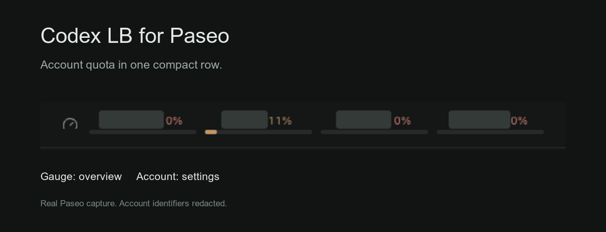

# Codex LB for Paseo

Quota, account health, and usage from [Codex LB](https://github.com/Soju06/codex-lb), inside Paseo.



## What it shows

- **Sidebar:** one compact row with a gauge icon and per-account bars. A shortened email prefix and remaining percentage share one line above each bar. The gauge opens the overview; an account opens its settings. Each bar shows that account's lowest reported quota; its period is in the account details. Up to six accounts appear, followed by an overflow count.
- **Quota:** remaining percentages across usable accounts. Credit capacity is used as a weight when every account reports it; otherwise the screen says **Account average**.
- **Accounts:** actual email, alias, plan, routing policy, quota credits, extra credit balance, reset countdowns, and available reset credits. Filter by email or by accounts that need attention.
- **Controls:** pause/resume, change routing policy, edit aliases, toggle quota warm-up, and use reset credits after confirmation. Guests remain read-only.
- **Usage:** requests, tokens, estimated USD cost, error rate, and token history for 24 hours, 7 days, or 30 days.
- **Paseo Usage:** a global Codex LB pool card. It uses Paseo's own usage cache, which can retain a result for five minutes. The plugin screen and sidebar refresh every 30 seconds by default.

The plugin displays the dashboard's data. Fetching it does not trigger a fresh upstream quota check.

## Install locally

Requires **Paseo 0.11.4 or later** on the daemon and app.

```sh
paseo plugin add https://github.com/sm1ee/paseo-codex-lb.git --ref v0.1.0
```

For a local checkout, use `paseo plugin install /absolute/path/to/paseo-codex-lb`.

Plugins must already be enabled in Paseo. Open **Codex LB** in the sidebar, or search
**Open Codex LB** in the Command Center.

## Connect

1. Open **Codex LB → Connection**.
2. Set the server URL. It defaults to `http://127.0.0.1:2455`.
3. Choose the refresh interval and usage period, then save.
4. Return to Codex LB and sign in with your dashboard password. Enter an authentication code if requested.

Guest login is available when the server enables it. Newer servers that request a username
show a username field. Proxy API keys do not authenticate dashboard endpoints.

On macOS, **Use saved Status Bar login** reads the existing Keychain password saved by
[Codex LB Status Bar](https://github.com/sm1ee/codex-lb-statusbar) for the exact server URL and selected role.
It does not change that Keychain entry. With **Save login in Keychain** enabled, the
plugin saves its own per-server login after authentication succeeds. macOS may ask for access.

Saved plugin logins reconnect automatically after a reload or restart. TOTP codes are never
stored; enter a new code when the server requires one. **Sign out** ends the current session
and suppresses automatic sign-in until the plugin restarts or you sign in manually.
**Forget saved login** deletes the plugin's Keychain entry without changing the Status Bar app's entry.

The server URL is reached **from the Paseo daemon**, so `localhost` refers to the daemon's
machine. **Open dashboard** opens the same URL on your current device; use a URL reachable
from that device if you need the link on mobile or another computer.

SSO-only dashboards need a password or guest login supported by the server; this version
does not implement browser SSO or send trusted-proxy identity headers. Finish bootstrap,
required password changes, and two-factor enrollment in the Codex LB dashboard.

## Quota and connection states

Period names come from reported durations. A missing duration stays **Primary** or **Secondary**;
it is not assumed to be five hours or a week. The API's explicitly named monthly field is **Monthly**.
Accounts reporting different durations are grouped separately. Missing percentages stay **Unknown**.

Paused, re-auth-required, deactivated, and unrecognized account states are excluded from the
aggregate. Rate-limited and quota-exceeded accounts remain included so an exhausted account
does not make the pool look healthier. Reset countdowns are per account: a pool does not
reset all at once.

If a request fails, the last fetched data stays visible with **Stale data** and its age.
An expired login clears the old account data and asks you to sign in again. The built-in
Usage source reports a failed fetch as unavailable instead of presenting stale quota as current.

## Reset credits

Select **Manage → Use reset credit** to load the current availability and see a confirmation.
Codex LB chooses the credit that expires first. Confirming spends one credit and cannot be undone.
Paused, signed-out, and deactivated accounts cannot redeem credits.

If a response is lost, **Retry same request** reuses the redemption ID so the server can return
the original result without spending another credit. Pending retry IDs stay in memory for the
current plugin run. After a reload, check the dashboard result before starting a new redemption.
The plugin never redeems credits automatically.

## Privacy

- Account emails appear on the main screen, with shortened prefixes in the sidebar. **Hide account names** replaces them with numbered labels on the screen and hides the sidebar prefixes. This is a display preference, not an access-control boundary.
- On macOS, saved passwords and optional usernames live in a dedicated per-server Keychain item (`sh.paseo.codex-lb.dashboard-login`). They are not written to plugin settings, logs, process arguments, or the repository. Session cookies stay in server memory.
- Passwords are saved only after authentication succeeds, including TOTP when enabled. Other daemon platforms support session-only sign-in; this version does not provide a native credential-store adapter for Linux or Windows.
- The backend calls only your configured Codex LB server. It does not follow redirects with credentials or export upstream account tokens.
- Account changes happen only through the controls you select. Account tokens stay in Codex LB; the plugin does not read them or restart services.
- Paseo host users with plugin access share this connection, as they share other host-scoped plugin settings.

## Development

```sh
npm ci --ignore-scripts
npm run typecheck
npm test
npm pack --dry-run --ignore-scripts
paseo plugin reload codex-lb
```

No build step or runtime npm dependencies are required. Paseo provides the SDK, React,
React Native, TanStack Query, and Zod. Tests cover quota weighting, duration grouping,
unknown values, authentication, Keychain storage, stale data, account permissions, reset
confirmation and idempotent retries, and responses arriving after a server change.

The native Keychain round-trip test is opt-in and deletes only its own temporary item:

```sh
PASEO_CODEX_LB_KEYCHAIN_TEST=1 npm test
```

## Credits

Inspired by [sm1ee/codex-lb-statusbar](https://github.com/sm1ee/codex-lb-statusbar),
particularly its dashboard API integration, quota display, and per-server saved login.
This plugin was implemented separately for Paseo.

API contracts were checked against [Soju06/codex-lb](https://github.com/Soju06/codex-lb),
including its dashboard overview and authentication endpoints, and the local server's OpenAPI schema.

## License

MIT.
